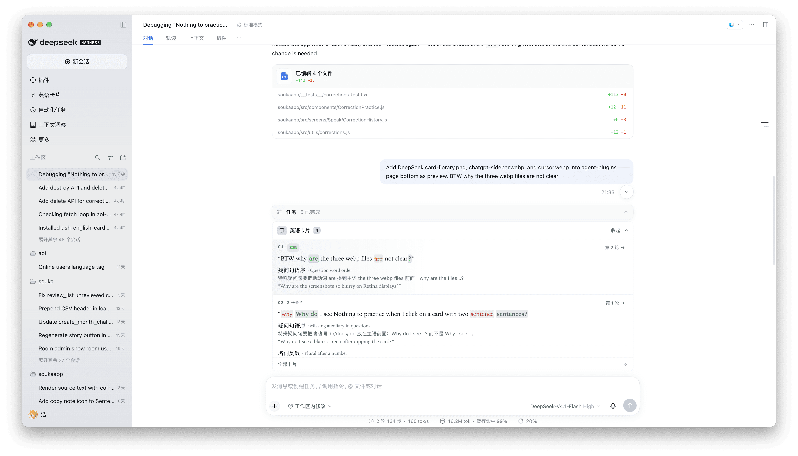
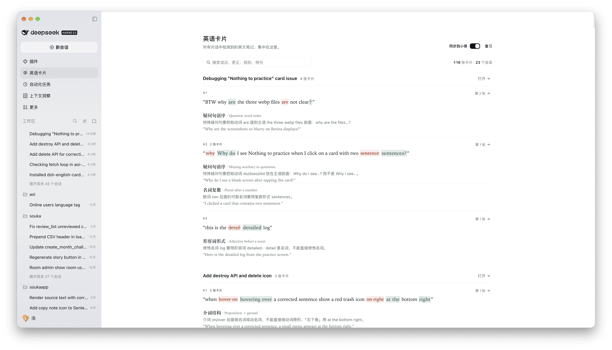

# English Cards

**English** | [中文](README.md)

Want to improve your English? Then put your English to work. Talking to an agent is the best chance you get to use English: it fills most of our day, and it can understand expressions that are not quite accurate.

To encourage you to communicate in English more often, the plugin detects grammar issues for you. While you use DeepSeek Harness it checks your English automatically and collects what it finds into study cards: a live deck above the composer and a searchable card library in the sidebar.

Get instant feedback while you chat in English, learn from your own mistakes, and feel your English improve.

## Preview





## Features

- **Composer deck**: shows the latest English note for the current conversation.
- **Card library**: collects notes from every conversation and searches grammar, corrections, rules, examples, or session titles.

## Sync to Aoi (off by default)

The English Cards header has a **Sync to Aoi** switch on the far right; it is off by default. With it off the plugin makes no network request, and every card stays on this device.

Turning it on runs an OAuth 2.1 authorization-code + PKCE flow: the plugin opens Aoi's authorization page in your browser (it asks you to sign in first if you are not).

The first successful authorization syncs the cards already on this device once; later captures sync incrementally.

## Install

### Plugin

Open **Plugins → Add plugin** and enter:

```text
dsh-english-cards
```

### Other agents

The plugin above is built for DeepSeek Harness. In Claude Code, ChatGPT/Codex, Cursor, and other [Agent Plugins](https://agent-plugins.org) hosts, install [aoilang/aoi-plugins → plugins/english-cards](https://github.com/aoilang/aoi-plugins/tree/main/plugins/english-cards).

- **Claude Code**: `/plugin marketplace add aoilang/aoi-plugins`, then `/plugin install aoi-grammar-cards@aoi-plugins`.
- **ChatGPT desktop / Codex**: `codex plugin marketplace add aoilang/aoi-plugins`, then install **English Cards** from the Plugins Directory (or run `codex plugin add aoi-grammar-cards@aoi-plugins`).


## Usage

Chat in English as usual. If there is a grammar mistake, the model calls tools automatically.

Click the cards above the composer to expand them, or click **All cards** / the sidebar's **English cards** to open the card library.


## License

MIT — see [LICENSE](LICENSE).
