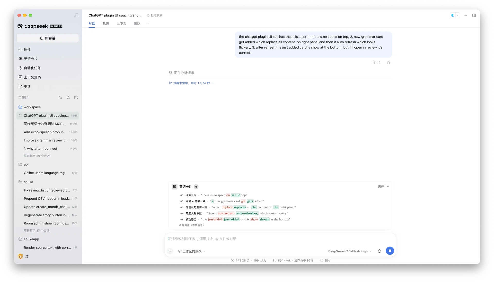
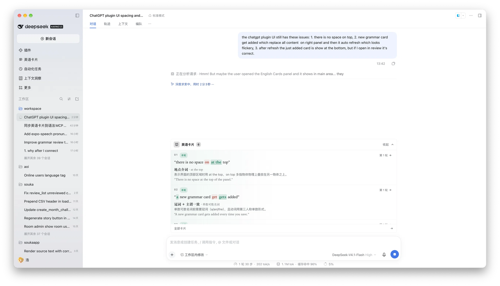
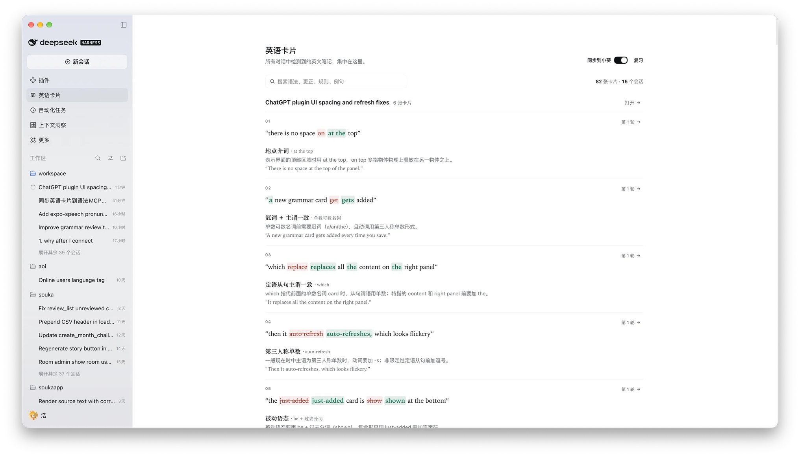

# 英语卡片

[English](README.en.md) | **中文**

在使用 DeepSeek Harness 时，自动检测英文语法，并收集成学习卡：输入框上方有一叠实时卡片，侧边栏有一个可搜索的卡片库。

## 预览

| 收起：输入框上方的卡片叠 | 展开：逐条看更正的词 |
| --- | --- |
|  |  |



## 功能

- **输入框卡片叠**：显示当前会话最新的英文笔记。
- **英语卡片库**：汇总所有会话的笔记，可按语法、更正、规则、例句或会话标题搜索。

## 同步到小葵（默认关闭）

英语卡片面板标题栏最右侧有一个「同步到小葵」开关，默认关闭。关闭时插件不发任何网络请求，卡片只保存在本机。

打开开关会走 OAuth 2.1 授权码 + PKCE：插件在系统浏览器打开小葵的授权页（未登录会先要求登录）。

首次授权成功后会自动把本地已有卡片同步一次（之后增量同步）。

## 安装

### 插件

在 **插件 → 添加插件** 中填入：

```text
dsh-english-cards
```

### 其他 Agent

上面的插件是给 DeepSeek Harness 用的。在 Claude Code、ChatGPT/Codex、Cursor 等支持 [Agent Plugins](https://agent-plugins.org) Agent里，请安装 [aoilang/aoi-plugins → plugins/english-cards](https://github.com/aoilang/aoi-plugins/tree/main/plugins/english-cards)。

- **Claude Code**：`/plugin marketplace add aoilang/aoi-plugins`，再 `/plugin install aoi-grammar-cards@aoi-plugins`。
- **ChatGPT 桌面版 / Codex**：`codex plugin marketplace add aoilang/aoi-plugins`，然后在插件目录里装 **English Cards**（或在 Codex 里运行 `codex plugin add aoi-grammar-cards@aoi-plugins`）。
- **Cursor 等 MCP 宿主**：添加 MCP 服务 `https://aoilang.com/grammar/mcp`，完成 OAuth，再粘贴插件提供的自定义指令，卡片才会稳定保存。


## 使用

用英文正常对话即可。如果有语法错误，模型会自动调用 `english_cards_capture`。

点击输入框上方的卡片展开，或点击 **全部卡片** / 侧边栏的 **英语卡片** 打开卡片库。


## License

MIT — see [LICENSE](LICENSE).
