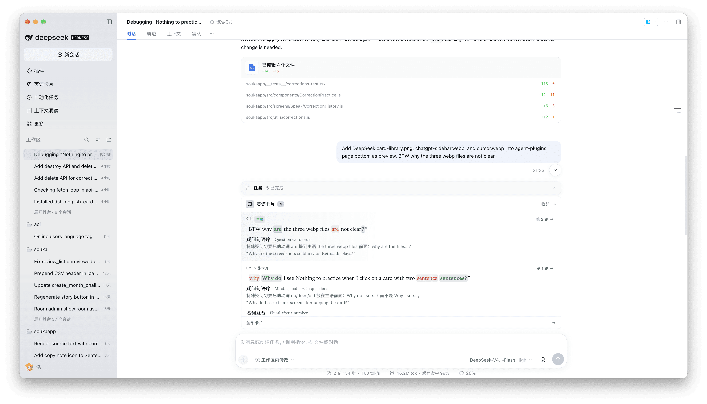
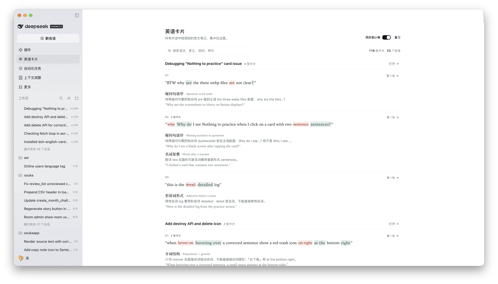

# 英语卡片

[English](README.en.md) | **中文**

想提高英语水平吗？那就把你的英语用起来。和Agent交互是最好的使用英语的机会，它占据了我们大部分的日常时间，也能够理解我们不那么准确的表达。

插件提供了自动识别语法问题的功能，在使用 DeepSeek Harness 时，自动检测英文语法，并收集成学习卡片。

通过即时反馈，激励你更多地使用英语沟通，使用自己的错误来学习，切实感受到英语的提升。

## 效果预览

输入框上方，展示当前会话中卡片

侧边栏，展示所有卡片


## 安装

### 插件

在 **插件 → 添加插件** 中填入：

```text
dsh-english-cards
```

## 功能

- **输入框卡片叠**：显示当前会话最新的英文笔记。
- **英语卡片库**：汇总所有会话的笔记，可按语法、更正、规则、例句或会话标题搜索。

## 同步到小葵（默认关闭）

英语卡片面板标题栏最右侧有一个「同步到小葵」开关，默认关闭。关闭时插件不发任何网络请求，卡片只保存在本机。

打开开关会走 OAuth 验证：插件在系统浏览器打开小葵的授权页（未登录会先要求登录）。

首次授权成功后会自动把本地已有卡片同步一次（之后增量同步）。


### 其他 Agent

上面的插件是给 DeepSeek Harness 用的。在 Claude Code、ChatGPT/Codex、Cursor 等支持 [Agent Plugins](https://agent-plugins.org) Agent里，请安装 [aoilang/aoi-plugins → plugins/english-cards](https://github.com/aoilang/aoi-plugins/tree/main/plugins/english-cards)。

- **Claude Code**：`/plugin marketplace add aoilang/aoi-plugins`，再 `/plugin install aoi-grammar-cards@aoi-plugins`。
- **ChatGPT 桌面版 / Codex**：`codex plugin marketplace add aoilang/aoi-plugins`，然后在插件目录里装 **English Cards**（或在 Codex 里运行 `codex plugin add aoi-grammar-cards@aoi-plugins`）。


## 使用

用英文正常对话即可。如果有语法错误，Agent会自动调用工具保存卡片。

点击输入框上方的卡片展开，或点击 **全部卡片** / 侧边栏的 **英语卡片** 打开卡片库。


## License

MIT — see [LICENSE](LICENSE).
